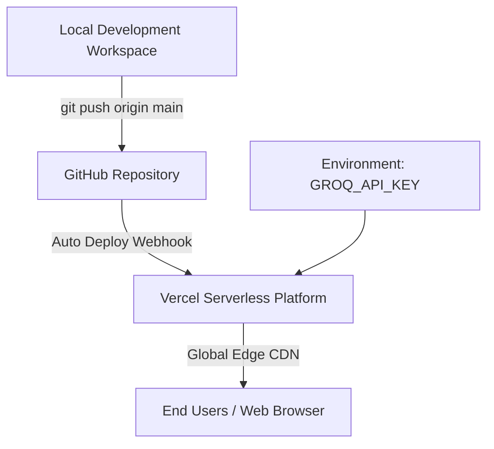

# SecondSelf — Vercel Deployment Plan

This document outlines the step-by-step production deployment strategy for **SecondSelf** (Personal AI Second Brain) to **Vercel**, covering build configuration, serverless architecture, environment secrets, and post-deployment validation.

---

## 1. Overview & Architecture Reference

- **Deployment Target**: **Vercel** (`vercel.com`)
- **Frontend Stack**: Next.js 14 (App Router), React 18, Tailwind CSS, Lucide Icons, Vis.js
- **Serverless API Routes**:
  - `/api/graph`: Pre-computed knowledge graph & metadata
  - `/api/notes`: PARA wiki notes reader with frontmatter parsing
  - `/api/ask`: Graph-RAG retrieval & Groq Llama 3.3 70B inference
  - `/api/capture`: Rapid inbox capturing
- **AI Inference Engine**: Groq Cloud API (`llama-3.3-70b-versatile`)
- **Vector Representation**: 384-dimensional dense vectors pre-baked in `data/embeddings.json`



---

## 2. Pre-Deployment Readiness & Bundled Data

Since Vercel executes serverless functions on an ephemeral edge filesystem:
- [x] **Wiki Directory**: Populated `wiki/` (`Projects/`, `Areas/`, `Resources/`, `Archives/`) committed.
- [x] **Pre-Computed Graph**: `data/graph.json` committed (38 nodes, 40 edges).
- [x] **Embeddings Vectors**: `data/embeddings.json` committed.
- [x] **Production Build Verification**: `npm run build` generates 100% clean optimized bundle (`○ /`, `ƒ /api/*`).
- [x] **Automated Test Suite**: All 33 Python pytest integration tests passing.

---

## 3. Step-by-Step Vercel Deployment

### Step 1: Push Code to GitHub
```bash
git add .
git commit -m "feat: complete elegant Next.js UI and Vercel serverless integration"
git push origin main
```

### Step 2: Import Project on Vercel
1. Log in to your [Vercel Dashboard](https://vercel.com/dashboard).
2. Click **Add New... ➔ Project**.
3. Select your GitHub repository: `Second-Self` (or search for `Rushi10082005/Second-Self`).
4. Vercel automatically detects **Next.js**:
   - **Framework Preset**: `Next.js`
   - **Root Directory**: `./` (default)
   - **Build Command**: `next build` (or `npm run build`)
   - **Output Directory**: `.next` (default)

### Step 3: Configure Environment Variables
Under the **Environment Variables** section on Vercel, add:
| Key | Value | Description |
| :--- | :--- | :--- |
| `GROQ_API_KEY` | `gsk_...` | Your Groq Cloud API Key |
| `GROQ_MODEL` | `llama-3.3-70b-versatile` | Default LLM model |

> [!NOTE]
> Users can also provide their own optional Groq API key directly via the in-app **Settings** modal, which is stored in their browser session.

### Step 4: Click Deploy
1. Click **Deploy**.
2. Vercel builds the project, optimizes assets, and assigns a live public URL (e.g. `https://second-self.vercel.app`).

---

## 4. Post-Deployment Verification Matrix

| Feature | Verification Step | Expected Result |
| :--- | :--- | :--- |
| **Navbar & Header** | Open live URL | Renders brand logo, live node counts (38 notes, 40 links), and settings modal. |
| **Interactive Brain** | Click *Interactive Brain* tab | Renders Vis.js force-directed canvas. Physics and category filters work smoothly. |
| **Node Inspection** | Click any node in graph | Slide-over inspector opens with summary; clicking "Read Full Note" switches to Explorer. |
| **Conversational RAG** | In *Ask SecondSelf*, click sample question | Synthesizes response with Groq Llama 3.3 70B, displaying source citation cards with match scores. |
| **Knowledge Explorer** | In *Knowledge Explorer*, select a note | Renders note metadata, PARA category badge, tags, backlinks, and markdown body. |
| **Quick Capture** | In *Quick Capture*, enter a note | Shows success confirmation and UUID assignment. |
